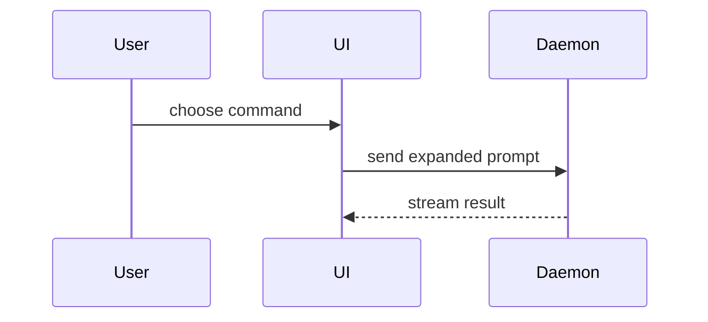

# File PR

## Before filing

Check whether a PR for the current branch already exists. If it does, use that
PR rather than creating a duplicate; update it only as requested.

Review the diff locally against the intended base branch (usually
`origin/main`) and make sure its contents match the user's goal.

## Title

PR titles usually become commit messages. Follow the repository's title
conventions; look at recently merged PRs and Git history for examples. Prefer a
concise, human-readable title that explains why the change matters:

BAD

> ❌ perf(server): negotiate permessage-deflate on the websocket

GOOD

> ✅ perf(server): cut websocket frame size by 70%+ with gzipping

Use measured claims only when supported by evidence.

## Description

Open with a simple explanation of the problem based on the user's original
prompt, then briefly explain the solution. Lead with the user's experience,
not an implementation inventory:

BAD

> ❌ Removed implicit workspace carry-over from every "new thread" entry point (cmd+n / cmd+shift+o, sidebar v1/v2 buttons, command palette). New threads inherit only the project from context; branch, worktree, and env mode always come from the configured defaults. Deleted buildContextualThreadOptions, startNewThreadInProjectFromContext, and the v1 sidebar's seed-context machinery.

GOOD

> ✅ My "new worktree" default was ignored when starting new threads on existing worktrees. Super unintuitive. Now your preferences always apply.

Use this template, keeping the opening explanation ahead of any visual:

```markdown
## Summary

<problem from the user's prompt, then the solution>

<diagram, diff-sketch, or tree, if it clarifies the change>

## Evidence

- **Before:** <screenshot/output/failing test run>
  **After:** <screenshot/output/passing test run>

## Merge Danger

**Door:** <one-way or two-way>

<optional: description>

**Blast Radius:** <one-word description>

<optional: potential ramifications of merge>

Created with <model> in <harness>.
```

End the description with the public model name and harness that made the
changes. Include subagent models that wrote part of the change. Use the model
name the harness reports. If model identity is unavailable, name the harness
without guessing a model.

## Sections

Keep prose brief, with no preamble before the problem statement. Use the user's
domain language from `GLOSSARY.md` when present.

### Summary

Pick the smallest view that makes the key point clear.

- Show logic or an algorithm as pseudocode:

```text
on(save)
  if content is unchanged
    return cached result
  write new content
  return fresh result
```

- Show runtime control flow as a call tree:

```text
submitForm
  createSession
    persistPrompt
    launchAgent
  navigateToSession
```

- Show UI structure as a component tree, including state and module boundaries that matter:

```text
<SessionPage> (apps/example/src/routes/session.tsx)
  useSessionEvents()
  <SessionToolbar>
    <RunSkillButton> (packages/ui)
```

- Show file responsibility or a broad refactor as a shallow file tree:

```text
src/
├── commands/       # parses user actions
├── sessions/       # owns session state
└── transport/      # sends API requests
```

- Show component interaction, control flow, or data flow with Mermaid:



- Use `diff` when the point is what changes and the surrounding shape already exists. Match the diff shape to the topic.

For a component change:

```diff
 <SessionPage>
   useSessionEvents()
   <SessionToolbar>
+    <RunSkillButton />
   <SessionTimeline>
+    <SkillResultCard />
```

For a file-layout change:

```diff
 src/
 ├── commands/
+│   └── show-me.ts       # expands the slash command
 ├── sessions/
-└── transport.ts
+└── transport/
+    ├── client.ts
+    └── stream.ts
```

For a call-tree or call-stack change:

```diff
 submitForm
   createSession
     persistPrompt
+    expandSkillMention
     launchAgent
-  navigateToSession
+  navigateToSession
+    subscribeToEvents
```

For a state or control-flow change:

```diff
 on(save)
-  write content
+  if content is unchanged
+    return cached result
+  write new content
+  invalidate cache
```

- Show the whole block when most of it is new, when omitted context would hide ownership or order, or when the user needs a copyable target shape:

```ts
function expandSkill(command: string): string {
  const skillName = command.slice(1);
  return `use the ${skillName} skill`;
}
```

#### Guidance

Place each visual next to the short text it supports. Keep only the calls, files, props, states, and boundaries needed to answer the user's current question or the options to resolve the current discussion point.

You may use one of these, you may use several, it is unlikely you will use all of them. Use your judgement and don't overwhelm the user.

### Evidence

Concrete evidence that the change works. Show a before and after.

Screenshots are S-tier - when the environment is set up for it and the change is visual.

Execution-based evidence is A-tier. Test results, console output. Show the exact test that now fails and passes, using pseudocode.

### Merge Danger

Describe whether it's a one-way or two-way door. You can walk back through two-way doors, but not one-way doors. A PR that is cheap to roll back is lower risk. Changes that involve destructive actions or hard-to-reverse decisions are one-way doors.

The blast radius is the potential impact or scope of the changes introduced by this PR. Consider all possibilities. Examples are layout shift, breakages for consumers, mobile responsiveness, etc.

## Submit

Before submission, check the title, description, quotes, and attachments for
secrets and private details.

Open a real PR rather than a draft so review bots run. If `gh pr create` fails
because the GraphQL rate limit is used up, open it through REST:

```sh
gh api repos/<owner>/<repo>/pulls \
  -f title='...' -f head='...' -f base='...' -F body=@<file>
```

Return the PR URL. If the user also asked to babysit it, continue with the
`babysit-pr` skill.

Do not post a follow-up PR comment unless it serves the user's request. When a
comment is needed, use the `leaving-pr-comments` skill.
